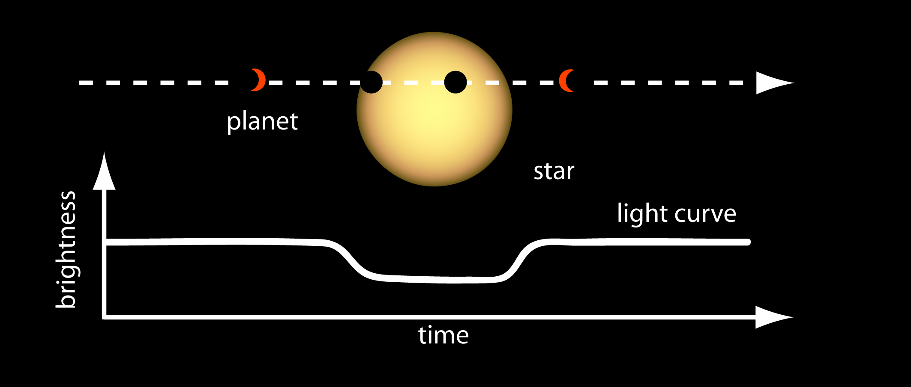
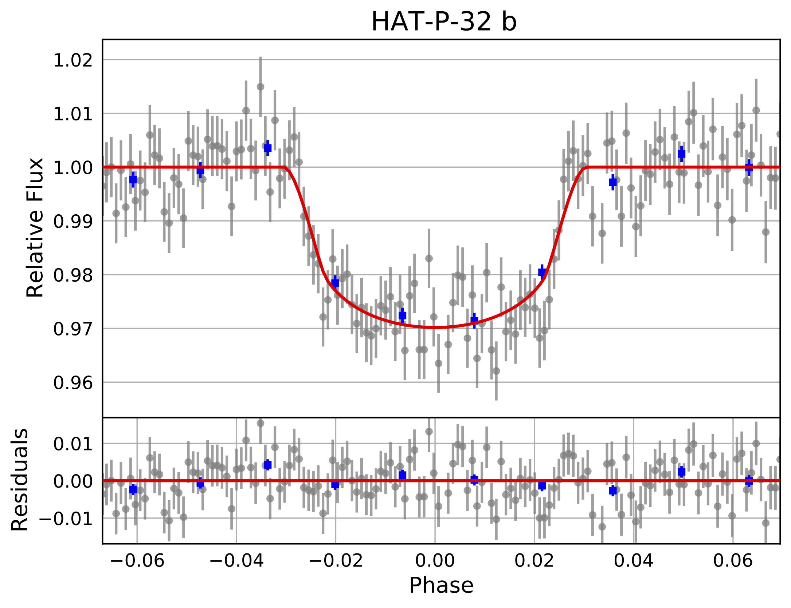
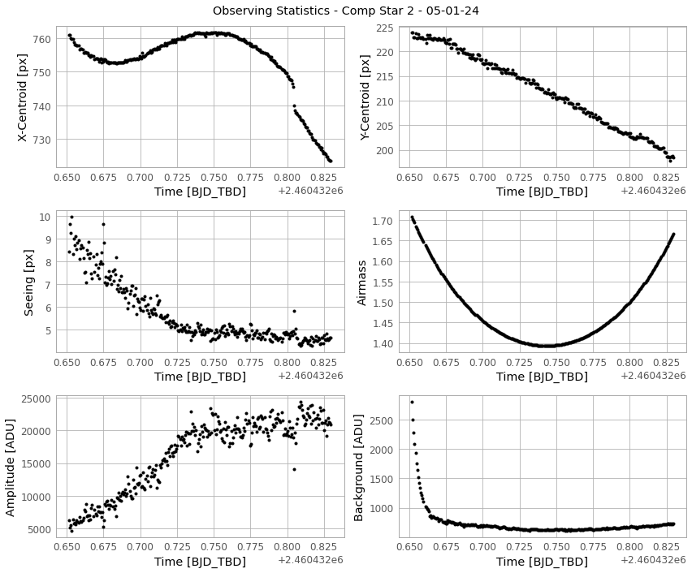
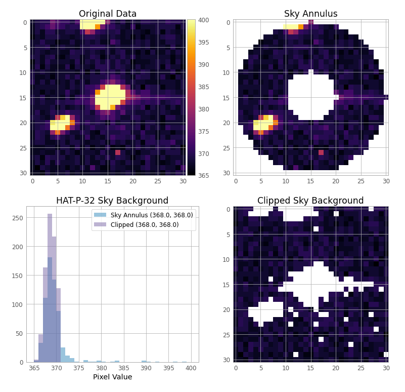
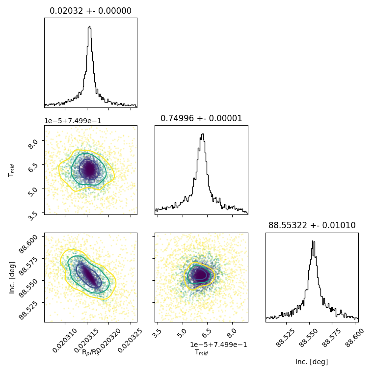
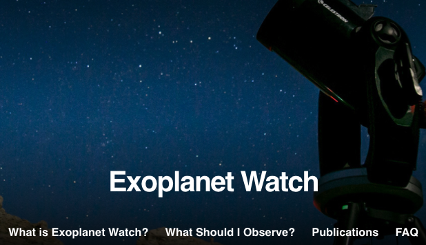

# EXOTIC (EXOplanet Transit Interpretation Code)

[](https://pypi.python.org/pypi/exotic/)
[](https://github.com/rzellem/EXOTIC/blob/main/LICENSE)
[](https://ui.adsabs.harvard.edu/abs/2020PASP..132e4401Z/abstract/)
[](https://join.slack.com/t/uol-ets/shared_invite/zt-2khgvlo2a-hcFH0S7aVIDT28_NMTOgWQ)
[](https://colab.research.google.com/drive/1CNRbMQC0FmiVC9Pxj_lUhThgXqgbrVB_)
[](https://hf.co/chat/assistant/66c0cb652a9c7710cec9341c)


A Python 3 package for reducing and analyzing photometric data of exoplanetary transits. As an exoplanet passes in front of its host star, the observed brightness of the star drops by a small amount. This drop in brightness is known as a [transit](https://exoplanets.nasa.gov/alien-worlds/ways-to-find-a-planet/#/2). Our software aids in creating lightcurves from images, enabling extraction of planetary parameters (e.g. Rp/Rs, Inclination, Mid-transit, etc.) through fitting astrophysical models to the data.


(NASA Ames)

## Claret and hybrid4 comparison

Full transit reductions now run an additional hybrid4/UltraNest fit after the
final comparison-star photometry has been selected. The standard Claret result
remains the primary result. Both limb-darkening laws are fitted to the same
LDTk PHOENIX intensity profiles, profile uncertainties, wavelength band and
existing `mu > 0.1` selection, generated in one atmosphere call.

The secondary fit uses the exact final time, flux, flux-error, airmass and
exposure arrays, final parameter bounds, duration prior and baseline treatment.
It does not repeat photometry selection, clipping or detrending. The existing
exposure integration also applies to hybrid4. Limb-darkening coefficients are
fixed during both transit fits; the atmosphere coefficient covariance is
reported separately. The existing Claret atmosphere fit's coefficient-sum
constraint is retained and recorded, rather than changing the primary model.

Selected full reductions write `LimbDarkeningComparison_<planet>_<date>.json`,
`.csv` and `.png` beside the normal outputs. The JSON and the new
`LIMB DARKENING MODEL COMPARISON` section in `FinalParams` report both parameter
sets, weighted posterior intervals, raw sampled uncertainties, reporting
adjustments, residual scatter, conditional log evidence and their differences.
The CSV contains the shared photometry and both models. Quick Look and stellar
variability modes retain their existing fitting behavior. If the primary fit
used manually supplied Claret coefficients without atmosphere profiles, the
comparison explicitly reports that the shared profiles are unavailable. Actual
secondary fitting failures are logged and reported without substituting another
model or changing the original result.

The spherical flux kernel is included locally under its MIT license from
[David Kipping's limbdarkfast](https://github.com/davidkipping/limbdarkfast),
revision `120caecc7d6d1d60c10cf0ed4ec27e4dede952db`; see
`exotic/api/limbdarkfast_LICENSE.txt`. No sibling repository or additional
third-party package is required. See [the replay script](scripts/README.md#claret-and-hybrid4-on-saved-light-curves)
to compare saved photometry independently of image extraction.

Both the primary Claret model and automatic hybrid4 comparison compute orbital
geometry, occulted flux and exposure integration in one C++ call per evaluation.
The Claret kernel retains PyLightcurve 4.0.4's precision-3 radial quadrature,
tabulated nodes and contact cases; its MIT license is included in
`exotic/api/pylightcurve_LICENSE.txt`. Saved-posterior orbital sensitivity batches
all draws for each orbit into one native call, including the original baseline
solver, duration prior and conditional impact-parameter prior normalization.
Grid selection, importance weights and uncertainty summaries remain in Python.
The independent Python reference now lives in `exotic.api.transit_reference`.
It retains PyLightcurve 4.0.4's orbital equations, transit/eclipse integration,
quadrature tables and eclipse-time solver without importing PyLightcurve or
loading its catalogues. Joint transit/RV/ephemeris fits use these local routines.
Normal EXOTIC fitting and Colab setup no longer require PyLightcurve. Stellar
atmosphere profiles still use the existing LDTK/PHOENIX path. Examples that
explicitly call ExoTETHYS can install the optional `exotethys` dependency extra
(`pip install 'exotic[exotethys]'`); that separate feature retains PyLightcurve.
Gaussian PSF fitting and aperture extraction also use this automatically built
library. The PSF kernel runs the bounded trust-region solver, Gaussian residuals
and numerical derivatives in C++; its SVD uses the existing SciPy/LAPACK runtime.
Centroid fits retain their existing starting points. Bounds, convergence
settings and centroid/shape selection are unchanged. The modern PSF flux fit starts from the measured
centroid shape: its former circular start left rotation unidentified and could
converge to different angle-bound minima after small rounding changes. Both
native and reference controls use this correction; explicit legacy flux mode
retains its circular start. Custom PSF functions retain their requested Python
model and the existing exceptional LM path remains available. Aperture grids
batch exact circle/pixel overlaps, weighted sky percentiles and high-side sigma
clipping in C++, converting only the local star cutout to native doubles.
Noise-budget bookkeeping remains in Python. The Photutils and SciPy BSD notices
are included alongside the native sources. For explicit numerical comparisons,
`scripts/benchmark_photometry_full.py --backend python` selects the retained
reference photometry; it is not an automatic fallback after a native failure.
Both models preserve
the existing circular/eccentric orbit convention, front/back treatment, exposure
candidate window, change tolerance and midpoint sample rule. Source package
installation builds this backend automatically;
platform wheels include the compiled library. Checkout launchers also prepare it,
and a direct CLI/API fit builds it on first use if it is missing or older than
its sources. Subsequent runs reuse it. Concurrent bulk workers share a build
lock, so they do not compile the same library simultaneously.

Prebuilt wheels carry the library and its build metadata, so a matching Colab
runtime can use it immediately. EXOTIC's library uses ctypes rather than the
Python or NumPy C API: wheels use a `py3-none` tag together with the operating
system and CPU tag, while package metadata retains the Python 3.12 minimum.
UltraNest has its own Python extension and needs a wheel for the runtime's
Python version. The tested Colab wheels are prepared in
[`wheelhouse/colab`](wheelhouse/colab/README.md), with exact software versions
and a download manifest. The shared installer can fetch them automatically
once those repository files are published; no per-notebook ZIP is needed.
Commit and push the prepared files before switching the notebook's setup cell.
The shared installer retains the runtime's NumPy, requests, Numba, Bokeh, SciPy,
Astropy, Matplotlib and scikit-image
using pip constraints when they satisfy the wheel's requirements. The source
requirements and revised Colab wheel support NumPy 2.4.6, requests 2.32.4,
Numba 0.64.0, Bokeh 3.8.2, SciPy 1.16.3, Astropy 7.2.3, Matplotlib 3.10.0
and scikit-image 0.25.2. An incompatible or absent dependency is resolved
by pip normally. Setup also reports the manifest, binary-download and pip
installation times; the small bootstrap dependencies use one pip invocation.
Installing those wheels avoids rebuilding either native component. Installing EXOTIC from a Git
URL is a source install and still compiles the backend. See
[the wheel-building instructions](scripts/README.md#prebuilt-colab-wheels).

The Colab wheelhouse also includes prebuilt imreg-dft and slimmer Astroquery,
Photutils, colour-science and colour-demosaicing wheels. They omit development
tests, examples and coverage reports while preserving runtime files and
licences. The shared installer installs these and the notebook prerequisites
in one pip call; the notebook needs no separate bootstrap installation.
The wheelhouse also supplies the 14 remaining packages needed by the tested
Colab base. Downloads use four workers, pip checks dependencies without
package-index queries, and install-time Python bytecode compilation is
disabled. Compatible preinstalled Colab libraries are still retained.

A C++ compiler is needed when building from source: MSVC **Desktop development
with C++** on Windows, Xcode Command Line Tools on macOS, or `g++`/`clang++` on
Linux. Linux/Colab builds use the available compiler; if none is installed,
install your distribution's C++ build tools once before setup. No extra Python
dependency or sibling checkout is required. Compiler failures are reported;
there is no automatic NumPy substitution. Compilation time is separate from
reported fit time. The kernel uses double precision without fast-math.
Comparison JSON records this separately as `backend_setup_seconds` and identifies
the backend for each law. For reference checks, the internal Claret setting
`_claret_backend='python'` selects the original evaluator, and
`fit._orbital_replay_backend='python'` selects the scalar replay loop. Neither is
an automatic fallback from a native failure.

The standard one-dimensional native transit fits also score complete UltraNest
likelihood batches in C++: impact-parameter conversion, duration prior, exposure
integration, airmass trend, fixed/free/profiled flux baseline and weighted
residuals. `lc_fitter(..., likelihood_backend='python')` keeps the Python scoring
loop for a matched control while retaining the selected transit evaluator.
The default `likelihood_backend='auto'` uses native scoring for standard C++
models and retains Python scoring for custom or Python transit models. An
explicit `'cpp'` request requires the native model and matching 1D fit arrays;
loading failures never select Python automatically. Comparison JSON records
`likelihood_backend` for each fit. Sampling bounds and prior transforms are
unchanged. Final plotting reuses uncertainty envelopes within each export and
recomputes them on the next export, including after a sampler resume.

Detector preparation also uses C++ for the standard two-dimensional frames:
exact integer-ADU histogram counts replace a full pixel sort, and local defect
medians use original good neighbours without padding a second full image.
Unresolved clusters retain SciPy's existing nearest-pixel operation and tie
handling. The low-tail rule, masks and float64 results are unchanged. Frame
loaders reuse owned buffers where possible, and read required FITS HDUs lazily.
Native errors propagate; general Python-only histogram argument types and
non-2D compatibility cases retain their reference implementation. The full
reduction benchmark's `--preparation-backend python` selects the previous
preparation path while retaining the chosen photometry and likelihood backends.

You can prepare or force a rebuild from the repository console:

```powershell
.\.venv\Scripts\python.exe -m exotic.api.native_build
.\.venv\Scripts\python.exe -m exotic.api.native_build --force
```

On Linux/macOS use `python -m exotic.api.native_build` in the existing environment.
The compatibility command `python scripts/build_hybrid4_cpp.py` does the same
work. Build products stay under `exotic/api/native`. Repository GUI launchers
run this checkout with the active Python environment and do not reinstall
EXOTIC or its dependencies on every launch. Install missing dependencies
separately using the installation instructions below.

Comparison JSON references its CSV and PNG by relative filename, so copying or
archiving the complete result directory preserves those links. Keep all
`LimbDarkeningComparison_*.json`, `.csv` and `.png` files alongside `FinalParams`
and the existing diagnostics. The JSON retains both posterior summaries,
likelihood-call counts, fit durations, goodness of fit, shared settings and
atmosphere profiles. These are conditional comparisons using fixed coefficients;
the files do not contain complete posterior sample chains.

Direct API comparisons can select the NumPy reference explicitly with
`run_hybrid4_fit(reference, atmosphere, backend='numpy')`.
The previous Python orbit/exposure path with C++ flux is retained explicitly as
`backend='cpp_flux'`; the default `backend='cpp'` runs the complete native model.
Native errors propagate without substituting an instantaneous model.

See [the C++ benchmark](scripts/README.md#cpp-hybrid4-benchmark) for repeated
paired fits using saved photometry and exactly the previously fitted atmosphere
coefficients.
See [the orbit/exposure benchmark](scripts/README.md#cpp-orbit-and-exposure-benchmark)
to measure the added improvement over the previous C++ flux backend.

## Installation + Setup

To install EXOTIC, use Python 3.12 or newer. Python 3.12, 3.13, and 3.14 are covered
by the compatibility test matrix. For the latest Python 3.14 maintenance release,
follow the virtual environment instructions for [Windows](<docs/regions/English/EXOTIC Installation Instructions for Windows 10.md>),
[macOS](docs/regions/English/EXOTIC-Installation-Instructions-for-Mac-Users.md),
or [Linux](docs/regions/English/EXOTIC-Installation-Instructions-for-Linux.md).
On Windows, the [Windows installation guide](<docs/regions/English/EXOTIC Installation Instructions for Windows 10.md>)
covers using the bundled CPython 3.12/3.13/3.14 x64 UltraNest wheels.

You can also install EXOTIC with Conda as follows:

1. Install [Anaconda](https://www.anaconda.com/products/distribution) or [Miniconda](https://docs.conda.io/en/latest/miniconda.html) (a minimal version of Anaconda) on your computer.
2. Create a new virtual environment and activate it:

   ```
   conda create -n exotic python=3.14 pip
   conda activate exotic
   ```
3. Install EXOTIC and its dependencies. On macOS and Linux:
   ```
   python -m pip install exotic
   ```
   On Windows, run this from the EXOTIC checkout so pip can use the bundled
   native wheels in the active Conda environment:
   ```
   python -m pip install --find-links wheelhouse --only-binary=ultranest -e .
   ```
4. MPI support is optional but recommended when your computer already has a compatible MPI runtime, or when you have permission to install one. It can support MPI-aware work in UltraNest and LDTk, but ordinary EXOTIC reductions run normally without it. EXOTIC detects working MPI support automatically; no EXOTIC setting is required. If an MPI runtime is available but `mpi4py` is not already installed, add the optional Python bindings with:
   ```
   python -m pip install "exotic[mpi]"
   ```
   If you cannot install system software, skip this step; no core EXOTIC reduction capability is removed.
5. (Optional) Run EXOTIC's graphical user interface (GUI):
   ```
   exotic-gui
   ```

After installing EXOTIC, you can verify the installation by running the following command in your terminal or command prompt:

```
python -c "import exotic"
```

If EXOTIC is installed correctly, you should not see any error messages. You can now start using EXOTIC by following the [examples](https://github.com/rzellem/EXOTIC/tree/main/examples) provided in the repository or by using our [sample dataset](https://github.com/rzellem/EXOTIC_sampledata/releases/). **If you're a new user**, we recommend starting with the beginner tutorial in Google Colab and then following our installation instructions for your operating system.

## Google Colab Cloud

The prepared automatic binary setup and its replacement Step 1 fragment are
documented in [the Colab setup instructions](scripts/README.md#automatic-colab-setup).
The current wheel set targets CPython 3.13 on Linux x86_64 with glibc 2.38 or
newer. This is a tested software snapshot; source changes need a new EXOTIC
wheel before they can be used by the binary setup.

Google Colab is a free cloud service that allows you to run Python code in a Jupyter notebook environment without having to install any software on your computer. We have a series of tutorials that you can run in Google Colab to learn how to use EXOTIC. You can access these tutorials by clicking on the following links:
- [Beginner Tutorial](https://colab.research.google.com/drive/1Xxx7XAwgRhtV7VmxpE1Jsb3SUumsZjWR) for getting started with [sample data](https://github.com/rzellem/EXOTIC_sampledata/releases/)
- [Standard Tutorial](https://colab.research.google.com/drive/1CNRbMQC0FmiVC9Pxj_lUhThgXqgbrVB_) for people who use data from MicroObservatory robotic telescopes (we can give you [data](https://exoplanets.nasa.gov/exoplanet-watch/how-to-contribute/data-checkout/) to convert to a light curve)
- [Advanced Tutorial](https://colab.research.google.com/drive/1_954Ec5bWeAH9r8xAxRZ1EmhF_03xVfe) for people who use observations from their own telescope

If those links are broken check our [website](https://exoplanets.nasa.gov/exoplanet-watch/exotic/welcome/) for the latest.

[](https://exoplanets.nasa.gov/exoplanet-watch/exotic/welcome/)

## New User Tutorials

The user community behind [Exoplanet Watch](https://exoplanets.nasa.gov/exoplanet-watch/about-exoplanet-watch/overview/) has created extensive documentation to help you get started with EXOTIC. We recommend you start with the following resources:

- [Installation instructions](https://github.com/rzellem/EXOTIC/tree/main/docs) for Windows, Mac, and Linux.
- [How to use EXOTIC on the Colab (video)](https://drive.google.com/file/d/10zlQRgT8iV3dSe0FVW7tiL-V86ewai_1/view)
- [How to use EXOTIC on the Colab](http://docs.google.com/document/d/1GLnfX1DdGPpd1ArKNcoF2GGV6pwKR3aEYuwjSQlhiZQ/edit?usp=sharing)
- [EXOTIC Tutorial (video)](https://drive.google.com/file/d/1x0kl8WtpEw9wS0JInbjVWvdzuTc9TTvS/view)
- [Exoplanet Watch Observer's Manual](https://docs.google.com/document/d/1KrGKRElbA8VG98quocr6QRUeLtKtrjW4pgX8o1BXDjw/edit?usp=sharing)
- [AI Chatbot for Exoplanet Watch](https://hf.co/chat/assistant/66c0cb652a9c7710cec9341c)
- These documents [in other languages](https://github.com/rzellem/EXOTIC/tree/main/docs/regions)

## Sample Data
We recommend you test exotic with a [sample dataset](https://github.com/rzellem/EXOTIC_sampledata/releases/) consisting of 142 `fits` files taken by a 6” telescope of the exoplanet HAT-P-32 b (V-mag = 11.44) observed on December 20, 2017. The telescope used to collect this dataset is part of the [MicroObservatory Robotic Telescope Network](http://microobservatory.org) operated by the Harvard-Smithsonian Center for Astrophysics.

A lightcurve from the sample dataset is shown below:



Exotic will output the final parameters in a text file and a plot of the light curve. The output will look similar to the following:

```
*********************************************************
FINAL PLANETARY PARAMETERS

          Mid-Transit Time [BJD_TDB]: 2458107.71406 +/- 0.00097
  Radius Ratio (Planet/Star) [Rp/Rs]: 0.1541 +/- 0.0033
           Transit depth [(Rp/Rs)^2]: 2.37 +/- 0.1 [%]
 Semi Major Axis/ Star Radius [a/Rs]: 5.213 +/- 0.061
               Airmass coefficient 1: 1.1626 +/- 0.0037
               Airmass coefficient 2: -0.1184 +/- 0.0024
                    Residual scatter: 0.55 %
                 Best Comparison Star: None
                    Optimal Aperture: 4.09
                     Optimal Annulus: 10.74
              Transit Duration [day]: 0.13 +/- 0.0017
*********************************************************

```

## Initializaton File

Get EXOTIC up and running faster with a json file. Please see the included file ([inits.json](inits.json)) meant for the [sample data](https://github.com/rzellem/EXOTIC_sampledata). The initialization file has the following fields:

```json
{
    "user_info": {
            "Directory with FITS files": "sample-data/HatP32Dec202017",
            "Directory to Save Plots": "sample-data/",
            "Directory of Flats": null,
            "Directory of Darks": null,
            "Directory of Biases": null,

            "AAVSO Observer Code (blank if none)": "RTZ",
            "Secondary Observer Codes (blank if none)": "",
            "Observatory Full Title": "",

            "Observation date": "17-December-2017",
            "Obs. Latitude": "+32.41638889",
            "Obs. Longitude": "-110.73444444",
            "Obs. Elevation (meters)": 2616,
            "Camera Type (CCD or DSLR)": "CCD",
            "Pixel Binning": "1x1",
            "Filter Name (aavso.org/filters)": "V",
            "Observing Notes": "Weather, seeing was nice.",

            "Plate Solution? (y/n)": true,

            "Target Star X & Y Pixel": [424, 286],
            "Comparison Star(s) X & Y Pixel": [[465, 183], [512, 263], [], [], [], [], [], [], [], []],
            "Comparison Star(s) RA & Dec": null
    },
    "planetary_parameters": {
            "Target Star RA": "02:04:10",
            "Target Star Dec": "+46:41:23",
            "Planet Name": "HAT-P-32 b",
            "Host Star Name": "HAT-P-32",
            "Orbital Period (days)": 2.1500082,
            "Orbital Period Uncertainty": 1.3e-07,
            "Published Mid-Transit Time": 2455867.402743,
            "Published Mid-Transit Time Standard": "UNKNOWN",
            "Mid-Transit Time Uncertainty": 4.9e-05,
            "Ratio of Planet to Stellar Radius (Rp/Rs)": 0.14886235252742716,
            "Ratio of Planet to Stellar Radius (Rp/Rs) Uncertainty": 0.0005539487393037134,
            "Ratio of Distance to Stellar Radius (a/Rs)": 5.344,
            "Ratio of Distance to Stellar Radius (a/Rs) Uncertainty": 0.039496835316262996,
            "Orbital Inclination (deg)": 88.98,
            "Orbital Inclination (deg) Uncertainty": 0.7602631123499285,
            "Orbital Eccentricity (0 if null)": 0.159,
            "Star Effective Temperature (K)": 6001.0,
            "Star Effective Temperature (+) Uncertainty": 88.0,
            "Star Effective Temperature (-) Uncertainty": -88.0,
            "Star Metallicity ([FE/H])": -0.16,
            "Star Metallicity (+) Uncertainty": 0.08,
            "Star Metallicity (-) Uncertainty": -0.08,
            "Star Surface Gravity (log(g))": 4.22,
            "Star Surface Gravity (+) Uncertainty": 0.04,
            "Star Surface Gravity (-) Uncertainty": -0.04
    },
    "optional_info": {
            "Pre-reduced File:": "/sample-data/NormalizedFlux_HAT-P-32 b_December 17, 2017.txt",
            "Pre-reduced File Time Format (BJD_TDB, JD_UTC, MJD_UTC)": "BJD_TDB",
            "Pre-reduced File Units of Flux (flux, magnitude, millimagnitude)": "flux",

            "Filter Minimum Wavelength (nm)": null,
            "Filter Maximum Wavelength (nm)": null,

            "Fast Aperture Mask (y/n)": false,
            "allow_pixel_alignment_fallback": true,
            "prefer_pixel_values_over_wcs_for_target": false,
            "use_psf_photometry": true,
            "use_aperture_photometry": true,
            "use_aperture_corrections_and_full_image_fwhm": false,
            "use_ensemble_photometry_rather_than_single_comp": false,
            "stellar_variability_only": false,
            "use_ensemble_photometry_for_stellar_variability": true,
            "require_apparent_magnitudes": true,
            "use_exactly_the_comps_provided": false,
            "allow_partial_comparison_ensemble": false,
            "maximum_number_of_ensemble_comparisons_for_transit": 5,
            "maximum_number_of_ensemble_comparisons_for_stellar_variability": 5,
            "photometer_fortuitous_variables": true,
            "use_single_comparison_for_fortuitous_variables": true,
            "use_nextastro_vsx_cache_first": false,
            "skip_low_comparison_coverage_rejection": false,
            "fit_lightcurve_to_every_comparison_candidate": false,
            "detrend_on_outoftransit_baseline": true,
            "final_fit_baseline_duration_multiplier": 1.0,
            "restrict_baseline_to_an_hour": true,
            "use_eebls_to_initialize_tmid_and_bounds": true,
            "pick_comparison_by_eebls_snr": true,
            "use_impactparameter_rather_than_inclination_to_fit": true,
            "require_comp_star": true,

            "Pixel Scale (Ex: 5.21 arcsecs/pixel)": null,

            "Exposure Time (s)": 60.0
    }
}
```

### Comparison-star mode tags

Put these tags in the top-level `"optional_info"` object. JSON booleans (`true` and `false`) are recommended. Every initialization boolean also accepts numeric `1`/`0` and case-insensitive strings `"y"`/`"n"`, `"yes"`/`"no"`, `"true"`/`"false"`, and `"on"`/`"off"`.

Transit comparison selection uses the existing preflight ranking to shortlist the first three candidates (or all candidates when fewer are available). After reducing that shortlist, EXOTIC selects among completed PASS or MARGINAL fits using the existing final-fit metrics. If none is acceptable, it continues in preflight order until an acceptable fit is found or the pool is exhausted. The existing first-PASS and promising-partial early exits remain active. Set `"exit_at_first_qc_pass_solution": false` to evaluate every ranked candidate before selection. Quick Look continues to use its existing least-squares search. The shortlist reduces the number of comparison candidates evaluated; each evaluated candidate retains its existing UltraNest settings, detrending, and refits.

With `"restrict_baseline_to_an_hour": true` (the default), EXOTIC still measures every valid frame but fits only frames from one hour before ingress through one hour after egress. Frames outside that window that survive the ordinary pre-fit sigma/raw-ratio clipping are shown in blue in the `Diagnostics/FullDataFullLightCurve` plot; the canonical `FinalLightCurve` shows the fitted black points, red rejection crosses, and model without the blue baseline overlay. Frames rejected by the ordinary pre-fit clipping passes remain excluded from the fit but are retained as red crosses in both plots for traceability.

For raw-image reductions, bias, dark, and flat calibration frames are combined through temporary disk-backed stacks so full-resolution calibration sets do not need to reside in RAM at once. When calibration frames are supplied, the resulting `MasterBias.fits`, `MasterDark.fits`, and `MasterFlat.fits` products are saved in the run's output directory and copied beside the light-science images with `CALTYPE`, `NINPUT`, and `NCOMBINE` metadata. On later runs, those canonical files are detected automatically (and excluded from the science-image list) and loaded directly, so the raw calibration stacks do not need to be rebuilt. Master filenames are matched case-insensitively, including tile-compressed `.fits.fz` versions (for example, `masterdark.fits.fz` and `masterflat.fits.fz`). If both versions exist, the uncompressed `.fits` master is preferred. A user may also provide either version directly in a calibration input field.

Raw-image reductions prefer per-frame WCS when WCS coverage is consistent across the dataset. With the default `"allow_pixel_alignment_fallback": true`, EXOTIC uses `"bad_wcs_threshold_percent"` to choose the safe path: sparse missing-WCS frames below the threshold are dropped and the retained sequence remains WCS-based; when the missing-WCS fraction reaches or exceeds the threshold, all frames are retained and legacy pixel alignment is available for frames without usable WCS. Set `"allow_pixel_alignment_fallback": false` to require WCS-only processing and drop every frame without celestial WCS. The existing `"Ignore WCS in Header and Do Manual Alignment? (y/n)": "y"` option explicitly enables pixel alignment for the entire run.

Comparison stars may be supplied in `user_info` using either `"Comparison Star(s) X & Y Pixel"` or `"Comparison Star(s) RA & Dec"`. Do not populate both. RA/Dec values may be decimal degrees, such as `[[31.04125, 46.68972]]`, or sexagesimal strings, such as `[["02:04:09.90", "+46:41:23.0"]]`. Sexagesimal values must be quoted because they are JSON strings; forms such as `[[02:04:09.90, +46:41:23.0]]` are not valid JSON. Supplied X/Y positions are converted to sky coordinates with the reference frame's WCS; during photometry those sky coordinates are projected independently through every retained frame's own WCS header.

| Reduction | Requested comparison mode | `optional_info` settings |
|---|---|---|
| Transit fit | Single comparison star (default) | `"stellar_variability_only": false`, `"require_comp_star": true`, `"use_ensemble_photometry_rather_than_single_comp": false` |
| Transit fit | Comparison-star ensemble | `"stellar_variability_only": false`, `"require_comp_star": true`, `"use_ensemble_photometry_rather_than_single_comp": true`, `"maximum_number_of_ensemble_comparisons_for_transit": 5` |
| Transit or variability run | Exactly the supplied comparison(s) | `"use_exactly_the_comps_provided": true`. Comparisons may be supplied as X/Y or RA/Dec. One supplied comparison is used alone; two or more are all used as one fixed ensemble. Automatic replacement, addition, VSX/stability vetting, ranking, and ensemble-size limiting are bypassed. |
| Transit fit | No comparison star | There is no tag that forces this mode. `"require_comp_star": false` only removes the requirement for a comparison star; it does not force target-only photometry. The current comparison-calibration FITS path still selects a single comparison or an ensemble. |
| Stellar-variability-only run | Single comparison star | `"stellar_variability_only": true`, `"use_ensemble_photometry_for_stellar_variability": false` |
| Stellar-variability-only run | Calibrated comparison-star ensemble (default) | `"stellar_variability_only": true`, `"use_ensemble_photometry_for_stellar_variability": true`, `"maximum_number_of_ensemble_comparisons_for_stellar_variability": 5` |
| Stellar-variability-only run | No comparison star | Not supported for raw-FITS absolute variability photometry; a single calibrated comparison or calibrated ensemble is required. A pre-reduced relative light curve can be supplied without raw comparison-star photometry, but it is not selected by a comparison-mode tag. |

The two ensemble limits are independent. `"maximum_number_of_ensemble_comparisons_for_transit"` caps only the transit-fit ensemble. `"maximum_number_of_ensemble_comparisons_for_stellar_variability"` caps both stellar-variability-only and fortuitous-variable ensembles. Each defaults to `5`, must be an integer of at least `2`, and has no configured upper limit. Increase either value to permit a much larger ensemble; EXOTIC will enlarge automatic candidate discovery for the corresponding ensemble where applicable, then use up to that number of surviving comparisons. Very large ensembles require more photometry work. Stellar-variability and fortuitous-variable ensembles can also retain fewer frames because every selected member must have a usable measurement in a retained frame. Transit and instrumental stellar-variability ensembles combine each frame with inverse-variance weights from the incoming per-star photometry errors and propagate that same weighted uncertainty to the light curve.

Ensemble settings retain a single-comparison fallback when EXOTIC cannot build a usable ensemble, except when `"use_exactly_the_comps_provided"` is true. Exact-comparison mode fails explicitly if the supplied reference cannot be measured; it never silently substitutes or drops a supplied comparison. This makes the same reference star or ensemble reproducible across multiple runs.

Set `"allow_partial_comparison_ensemble": true` to continue with measurable ensemble members when some supplied comparisons have no usable flux series, including in exact-comparison mode. One remaining measurable member is sufficient to attempt the reduction. Exact mode still prevents additions and substitutions; this option explicitly permits omissions. Available members also contribute in frames where other members have rejected measurements. Every omission, its reason, the retained members, their usable-frame counts, and incomplete frame coverage are recorded in `ComparisonEnsemble.json`, the run log, final-parameter results and transit report metadata. The default is `false` in EXOTIC. Updated TransitLab enables it by default through **Advanced → Continue with available ensemble members**, and displays the warning on the Results tab. Turn it off to require the full supplied reference set. Ordinary measurement and fitting failures still report their actual cause.

Differential-magnitude CSV and plot products are always attempted independently of catalogue calibration. Set `"require_apparent_magnitudes": false` when catalogue-calibrated apparent magnitudes are not required; EXOTIC still writes apparent-magnitude products when calibration is available. Stellar-variability apparent and differential magnitudes use the raw target/reference flux ratio and are explicitly not airmass-corrected, because a real time-dependent stellar signal can be correlated with airmass. Airmass remains in the output as metadata.

Flux-bearing result files retain both magnitude representations. Final-lightcurve and differential-magnitude CSV rows explicitly include the raw, uncorrected differential magnitude and uncertainty alongside the corrected differential magnitude and uncertainty, plus apparent magnitude and uncertainty where applicable (or `na` when no catalogue calibration is available). Transit AAVSO files retain their standard exoplanet columns and add one preserved `#MAGNITUDE-XC` record per data row containing both raw and corrected differential values and the applied correction factor. When weighted linear out-of-transit baseline detrending is applied, `#OUT_OF_TRANSIT_BASELINE-XC` records the formula, BJD_TDB reference time, intercept, and slope; the standard `DIFF` and `ERR` rows are restored to their pre-detrending values and `DETREND_2` carries the correction function, making the operation reversible from the AAVSO file. AID rows retain the standard 15-column Extended format, use original geocentric JD values in `#DATE=JD`, and store raw differential values as plain `NOTES` text in the form `DIFFMAG=...;DIFFERR=...` while `MAG` and `MERR` remain the apparent magnitude measurement. Transit AAVSO files continue to use `#DATE_TYPE=BJD_TDB`. All transit and AID AAVSO files are written in an `AAVSO_Files` subfolder of their corresponding output directory. That folder also receives copies of the final-lightcurve PNG, PDF, and CSV; every FOV finder-chart PNG and PDF; the normal, final, and zoomed triangle plots; the KTMF QC PNG and PDF; and the prior-versus-posterior comparison PNG and PDF. Finder charts label every selected comparison member, including ensembles and comparisons sourced outside AAVSO. This preserves the target-minus-reference measurement needed to apply a revised apparent-magnitude calibration later. Each reduction writes its run log from startup through shutdown to a unique `Diagnostics/EXOTIC_RunLog_<timestamp>_pid<PID>.log`, so separate or midnight-spanning runs do not overwrite or split one another.

For fortuitous VSX variables found during a transit reduction, `"photometer_fortuitous_variables": true` turns their photometry on; `"use_single_comparison_for_fortuitous_variables": true` selects one comparison (the default), while `false` requests an ensemble capped by `"maximum_number_of_ensemble_comparisons_for_stellar_variability"`. Fortuitous-variable differential products remain available when catalogue calibration is unavailable. Fortuitous-variable photometry has no no-comparison mode.

`photometer_fortuitous_variables` defaults to `true` for full FITS reductions with a WCS. EXOTIC searches the field in VSX, retains unsaturated stars whose reference-image source-plus-sky noise estimate implies an internal error below 0.05 mag, and measures each retained variable against one calibrated comparison star by default, or against its own calibrated comparison ensemble when `"use_single_comparison_for_fortuitous_variables"` is `false`. Exported light curves also retain only frames whose final comparison-calibrated internal magnitude error is below 0.05 mag. Each VSX target uses its own frame-level saturation mask: saturation of the exoplanet target does not remove that image from the VSX target's run, while saturated measurements of that VSX target or a reference star are masked only for the affected source and frame. The ensemble's high-side comparison-catalog error sigma clip has a 0.01 mag minimum threshold, so comparison errors at or below 0.01 mag are never rejected by that clip. Every ensemble AAVSO AID file includes an `#ENSEMBLE-COMPARISONS-XC` JSON header listing every selected comparison star with its label, RA, Dec, pixel position, and catalog calibration. Per-star plots, magnitude CSV, and ensemble-selection JSON are written below `variables/optimal_variables/<name>/` when the VSX period is at most 10 days and amplitude is at least 0.3 mag, or below `variables/normal/<name>/` otherwise; each AAVSO AID file is placed in that variable directory's `AAVSO_Files` subfolder. Skipped variables are recorded only in the shared `variables/FortuitousVariables_<date>.json` manifest and do not receive an object directory. Set `"photometer_fortuitous_variables"` to `false` to disable these products.

When fortuitous variables have apparent-magnitude measurements, `variables/AAVSO_Files/` receives both `AID_AAVSO_FortuitousVariables_<date>.txt` with all measured variables and `AID_AAVSO_FortuitousVariables_AUIDOnly_<date>.txt` containing only those with an AUID. Both preserve the existing order: optimal variables first, then increasing reference-image estimated magnitude error, then name. The AUID-only file contains headers and no measurement rows if none of the measured variables has an AUID. The shared manifest records their paths as `combined_aid` and `combined_aid_auid_only`.

`use_nextastro_vsx_cache_first` defaults to `false`. When enabled, fortuitous-variable discovery queries `https://photometry.nextastro.org/vsx_query` first. EXOTIC falls back to AAVSO when the cache fails or returns no objects. Full-schema cache responses supply period and amplitude directly; legacy cache responses are enriched from AAVSO for optimal/normal classification.

Nested transit fits sample impact parameter by default and derive inclination from the joint posterior samples, retaining correlations with a/Rs and any sampled eccentricity parameters. Triangle plots display inclination in degrees by transforming each joint posterior sample; fitting still uses impact parameter. Standard reductions keep eccentricity and argument of periastron fixed to their nominal values, so inclination intervals are conditional on those values. Final parameter reports and posterior comparison plots use medians and asymmetric 68% equal-tail credible intervals. The 95% upper limit on b and 95% lower limit on inclination are also provided, without a cutoff that classifies a transit as central. These intervals use UltraNest's posterior weights or its equally weighted posterior samples. `POSTERIOR UNCERTAINTY REPORTING` in the final JSON and `#POSTERIOR-XC` in AAVSO files retain numerical summaries, best-fit model values, and local fit uncertainty approximations separately. Empirical red-noise adjustments remain separate estimates and do not rescale posterior credible intervals. Standard AAVSO result fields retain their symmetric format for compatibility.

NASA orbital values, asymmetric errors, limit flags and publication references are retained together per source. When the latest eccentricity constraint is an upper limit, new reductions explicitly assume a circular nominal orbit (`e=0`); the limit is not adopted as a measured eccentricity. `external_orbital_uncertainty` reports a separate deviation envelope across the quoted region, including every unspecified periastron orientation. No probability density or best value is inferred below an upper limit, and no confidence level is inferred from NASA's limit flag. The inclination endpoint summaries preserve the saved joint b/a/R* samples and posterior weights. Orbital speed, approximate duration-preserving a/R* and stellar-density deviations are also recorded. These envelopes are sensitivity diagnostics, not joint credible intervals or a re-fit; they do not change saved model values, photometric posterior errors or weights. Quoted confidence regions retain a probability tail outside the envelope. Measured e/omega error regions are treated as envelopes as well, without inventing their missing covariance. Different publications are alternatives, since they can reuse RV data; unknown star-versus-planet omega conventions cover both interpretations.

For an override run or a confidence level verified from the paper, supply `optional_info.orbital_constraints`, a list of records with `source`, `omega_convention` (`planet`, `star`, or `unspecified`), and `ecc`/`omega` objects. Each object contains `value`, `kind` (`measurement` or `upper_limit`), optional `error_plus`/`error_minus`, and optional `confidence_probability`. For example, `{"source":"published RV limit", "ecc":{"value":0.025,"kind":"upper_limit","confidence_probability":0.9545}}`. Source records with missing uncertainties remain explicitly unspecified; missing errors are not treated as zero.

Outputs retain the weighted posterior histogram peak for each parameter. Uniform histogram bin counts maximise an effective-count weighted adaptation of [Knuth's evidence criterion](https://arxiv.org/abs/physics/0605197), searching every integer from one to the number of distinct positive-weight draws. The effective count is `1/sum(normalised weights squared)`. This adaptation is an approximate Monte Carlo rule, with its objective, search range, selected score and bin width recorded; it is not a universal or bin-origin-independent definition of a mode. Full-posterior edges and estimates stay fixed when zooming. Gaussian posterior centres and sigmas (weighted means and standard deviations) are reported for non-geometry parameters only. **No Gaussian or truncated Gaussian is fitted to impact parameter or inclination**; these retain weighted histograms, asymmetric intervals and one-sided limits. Histogram peaks, Gaussian approximations, posterior medians and best joint transit-model values remain separate. Tmid differences are also recorded in seconds. Confidence is stated once for the figure rather than repeated on each parameter. JSON and AAVSO `#POSTERIOR-XC` retain these estimates; conventional AAVSO Tc remains the fitted transit-model value.

For a fit with saved joint posterior draws and its original likelihood context, orbital uncertainty additionally uses temporary likelihood-and-prior-ratio importance weights to evaluate alternative fixed orbits. This runs neither an optimiser nor a sampler and changes no stored fitted value, error or posterior weight. It retains exposure integration, the baseline, duration prior and the normalisation of the existing geometry-dependent b prior. The final JSON includes `ORBITAL RANDOM AND SYSTEMATIC UNCERTAINTY`, with conditional random intervals and orbital-assumption shifts for Tmid (seconds), Rp/R*, a/R*, b and inclination. Scanned extrema are **explored sensitivity extrema**, not certified continuous global bounds or standard deviations; refinement differences, effective sample counts, largest weights, likelihood replay differences and support expansion are diagnostics without a rejection threshold. Analytic geometry envelopes remain available separately. Upper limits and marginal e/omega errors do not identify a joint probability distribution, so an extra orbital random sigma is explicitly unspecified and the sensitivity envelope is not added in quadrature.

When available, a source record may supply `joint_posterior: {"ecc": [...], "omega_planet_degrees": [...], "weights": [...]}`. Paired samples retain the external RV covariance; weights are optional and default to equal weights. External weights remain fixed rather than being updated by the transit. The law of total variance separates average within-orbit transit variance from between-orbit random variance, and reports their total random sigma alongside the reference-to-mixture mean shift. This is a modular external-orbit mixture, not a joint re-fit of eccentricity and periastron.

### UltraNest CPU start gate

By default, each UltraNest fit waits until total system CPU usage is at or below **50%** before starting. EXOTIC measures CPU usage over one second and, while above the threshold, reports the wait and checks again after five seconds. There is no wait timeout. Existing fits continue running; photometry and least-squares fitting are unaffected. CPU measurement failures are reported as errors rather than silently bypassing the gate.

Configure the gate in your init JSON:

```json
"optional_info": {
  "ultranest_cpu_gate": true,
  "ultranest_cpu_threshold": 50
}
```

Set `ultranest_cpu_gate` to `false` to disable it. Command-line overrides are `--ultranest-cpu-gate`, `--no-ultranest-cpu-gate`, and `--ultranest-cpu-threshold 50`. For server jobs or direct Python fitting APIs, set `EXOTIC_ULTRANEST_CPU_GATE=0` (off) or `1` (on), and `EXOTIC_ULTRANEST_CPU_THRESHOLD=50`. Precedence is command line, explicit init-file value, environment, then defaults. Thresholds may be any finite percentage from 0 through 100; setting 100 permits startup at any measured load.

The gate runs before likelihood worker pools are created and covers all EXOTIC UltraNest fitters, including subsequent fit attempts and extensions. It checks current load independently in each process, so simultaneous jobs can pass together, and load can rise above the threshold after startup. This is a start gate, not a cap on running CPU usage or a fixed concurrency limit. MPI fitting APIs coordinate the decision across ranks using rank zero's host CPU usage.

### Bounding UltraNest fitting effort

EXOTIC automatically estimates a likelihood-evaluation budget for each comparison
candidate. No user setting is required. The initial sampling allowance scales
with the number of sampled dimensions, live points and requested effective
samples: `32 * max(live_points, min_ess) * (dimensions + 1)` calls. If sampling
uses that allowance, EXOTIC uses its measured cost per nested iteration, remaining
live-tail mass, effective sample count and evidence uncertainty to estimate the
remaining work. It doubles that estimate for headroom, within the existing API
ceiling (normally 200,000 calls). APIs without a ceiling use four times their
initial allowance as the ceiling. This is a computational heuristic; it cannot
predict whether a transit is detectable or guarantee posterior convergence.

That projection is made once per candidate. Posterior retries, baseline refits
and residual-rejection refits share the resulting allowance, so repeatedly
changing bounds cannot continually renew it. Natural completion can finish
earlier. Priors, detection criteria and comparison-star selection are unchanged.
Deferred live-point extensions carry forward the fit's remaining allowance.
A required final fit on full-resolution data after a binned search estimates
its own allowance, shared by all of that final fit's refinements.
UltraNest can finish its current proposal batch before stopping, so the actual
count can exceed the ceiling.

At the ceiling EXOTIC retains the sampled result and reports that posterior
convergence may be incomplete; its progress line says `stopped`. Fit results
also record `exotic_call_limit` with the requested and actual counts. This is
an effort limit. Once the shared allowance is spent, EXOTIC stops further posterior
and residual-rejection refinements and keeps the last sampled fit with its
matching measurements. Each comparison candidate gets its own allowance.
Budget summaries are saved as `ultranest_evaluation_budget` in fit/report
metadata, including the automatic calculation and pilot diagnostics. Standalone
nested-fit searches also share the allowance across their posterior retries;
direct `run_reactive_sampler` calls estimate the allowance for that invocation.

Advanced callers can override automatic estimation with a positive integer in
`optional_info.ultranest_max_ncalls` or `EXOTIC_ULTRANEST_MAX_NCALLS`. An explicit
init value takes precedence over the environment. Omission or `null` inherits the
environment and otherwise uses automatic estimation; `"auto"` explicitly selects
automatic estimation. A smaller API ceiling still applies.

## Third-Party GUI Launchers

### TransitLab
[TransitLab](https://github.com/ArtTrail/TransitLab) is a cross-platform desktop GUI launcher and workflow assistant for EXOTIC, available for Windows, macOS (Apple Silicon), and Linux. It guides observers through every step of a reduction run: loading FITS frames, image analysis, target parameter lookup via the NASA Exoplanet Archive, running EXOTIC, and submitting results to AAVSO, all from a single tabbed interface.

**Features include:**
- Automatic plate solving (astrometry.net or ASTAP)
- NASA Exoplanet Archive integration for automatic target parameter lookup
- AAVSO comparison star selection
- Transit geometry visualizer with real-time animated light curve preview
- Session history browser
- Automation mode for unattended reductions
- Built-in Python & EXOTIC setup wizard (install, upgrade, uninstall without the command line)
- AAVSO submission directly from the app

[Download the latest release](https://github.com/ArtTrail/TransitLab/releases/latest) | [Source code](https://github.com/ArtTrail/TransitLab)

## Features and Pipeline Architecture

- Automatic Plate Solution from http://nova.astrometry.net

  NextAstro plate-solve requests identify the EXOTIC version and `exotic` request
  origin. They also send the image's observatory/site label when available, using
  FITS `OBSID`, `TELID`, `SITEID`, `OBSNAME`, then `OBSERVAT` in that order.
  Programmatic callers can set `NextAstroPlateSolution(..., site="eco1")` explicitly.
  Dalton (`https://astrometry.daltonnextastro.org`) is the primary NextAstro
  solver. Shadowserver (`https://astrometry.nextastro.org`) is tried only for
  a connection failure, including when an old configuration names Shadowserver
  first. Connection/read timeouts, HTTP errors, polling expiry and failed or
  unsolved searches are reported without sending that job to Shadowserver.
  Images without this metadata can still be solved; the astrometry server's
  `/usage` report groups unnamed callers by software and source IP.
  EXOTIC embeds its own shared app key and sends `X-NextAstro-Client: exotic`.
  Google Colab runtimes automatically use a separate `exotic-colab` key, report
  `EXOTIC-Colab/<version>`, and set the origin to `exotic-colab`. Update EXOTIC in
  the notebook environment to enable this; no notebook key setup is needed.
  The server requires a matching app key for submissions. Applications embedding
  `NextAstroPlateSolution` can pass their own `client_name`, `client_api_key`,
  `software_name`, and `origin` arguments. TransitLab uses its separate app key.

- Resolve targets with [NASA Exoplanet Archive](https://exoplanetarchive.ipac.caltech.edu/) + retrieve light curve priors

- Hot Pixel Masking

- Image to image alignment for centroid tracking

- Optimal Aperture Photometry

- PSF Photometry



- Stellar masking in background estimate



- Multiple comparison star + aperture size optimization

- Non-linear 4 parameter limb darkening with [LDTK](https://github.com/hpparvi/ldtk). For a list of compatible filters please see: [filters.py](https://github.com/rzellem/EXOTIC/blob/main/exotic/api/filters.py)

- Light curve parameter optimization with [Nested Sampling](https://johannesbuchner.github.io/UltraNest/readme.html)



## Contributing to EXOTIC

EXOTIC is an open source project that welcomes contributions. Please fork the repository and submit a pull request to the `develop` branch and join our slack channel to get ahold of our team. We are always looking for new contributors to help us improve the software and documentation.

## Citation
If you use any of these algorithms in your work, please cite our 2020 paper: [Zellem, Pearson, Blaser, et al. 2020](https://ui.adsabs.harvard.edu/abs/2020arXiv200309046Z/abstract)

Please also include the following statement in your paper's Acknowledgements section:
>This publication makes use of data products from Exoplanet Watch, a citizen science project managed by NASA’s Jet Propulsion Laboratory on behalf of NASA’s Universe of Learning. This work is supported by NASA under award number NNX16AC65A to the Space Telescope Science Institute.

## Timestamp selection and ephemeris standards

FITS timing compares the stored precision of usable numeric and date timestamps rather than taking the first header key. Explicit midpoints compete with start/end midpoints and start plus half exposure; `TIMEPIXR` and `TIMESYS` are respected. A precise `DATE-OBS`/`DATE-END` pair therefore replaces a rounded `MJD-OBS` when available. `TimestampSelection.json` records all candidates, the selected source, estimated decimal resolution and conversion. Resolution describes the stored digits, not calibrated shutter or clock accuracy. Ambiguous generic `BJD` headers remain diagnosed; disagreements do not reject frames.

Earth-orientation prediction age triggers a reference-table refresh, rather than rejecting a reduction. When predictive values exceed Astropy's configured `auto_max_age`, EXOTIC tries the configured mirror (USNO by default), Astropy's maintained `astropy-iers-data` snapshot on GitHub, and `https://downloads.nextastro.org/iers/finals2000A.all`, followed by the IERS standard-product URL and finally the configured primary publisher. Duplicate URLs are tried only once. Each failed download or parse is logged. If none supplies predictions within that refresh age, EXOTIC continues with the newest available table and logs its source, prediction start, and age. The same table is reused for frame timestamps, computed airmass, and reference-epoch conversions; sources are not retried per frame. An explicit `auto_download=False` remains offline. Astropy's global download and age settings, including leap-second update behavior, are preserved; only the selected interpolation table is temporarily installed for the calculation. A new reduction permits another refresh. Other calculation failures still propagate.

On startup, EXOTIC initializes barycorrpy's IERS-B cache from the official snapshot installed with `astropy-iers-data` if no cached table exists, and logs that source. Existing cached IERS-B data is preserved. This prevents barycorrpy's import-time download from blocking startup on a clean machine or an offline runner; it uses the same barycentric calculator. The IERS-A refresh behavior described above still applies during calculations.

Stale UT1 predictions affect the station's Earth-rotation correction, not the UTC timestamp or leap-second count. The geometric barycentric timing sensitivity is at most about 1.55 microseconds per second of UT1 error for an equatorial ground station (`Earth radius × rotation rate / speed of light`). This is a sensitivity estimate, not a measured error for a particular table. Calculated airmass also depends on Earth orientation, especially near the horizon; table age alone does not quantify the final curve's error.

Archive ephemerides retain `pl_tsystemref` and their publication. New initialization files use `Published Mid-Transit Time`, `Published Mid-Transit Time Standard` (for example `BJD_TDB` or `BJD_UTC`), and `Published Mid-Transit Time Reference`. Existing qualified epoch keys remain accepted. Old EXOTIC's `BJD-UTC` label was also applied to TDB archive values, so legacy epochs are checked against a matching published archive epoch before conversion. A known BJD receives only a clock conversion; JD/HJD references also require their position-reference conversion. Source epoch, standard, correction and verification status are retained. An unverifiable standard is reported explicitly and the existing numeric model convention continues; no timing error distribution is invented.

Final JSON (`TIMING REFERENCE AND TIMESTAMP SELECTION`) and AAVSO (`TIMING-XC`) include this provenance. When both `MJD-OBS` and `DATE-OBS` exist for every retained observation, paired deterministic transit fits calculate their actual Tmid difference using identical photometry, errors, baseline masks, parameter bounds, exposure integration and duration prior. Eccentricity and periastron remain fixed. The report contains both BJD-TDB Tmid values, `date_obs_minus_mjd_obs_seconds`, optimizer diagnostics and the free parameters. These are joint point estimates, not posterior medians or histogram/Gaussian peaks; they do not overwrite the production fit. Missing comparison data or a calculation error is reported rather than replaced by an average timestamp shift.

Colab and GUI initialization writers preserve epoch standards and publication references as metadata. The selected epoch alias determines its metadata; a different epoch field cannot supply its time standard. Pre-reduced `BJD_UTC` receives a clock conversion only, and hyphenated `BJD-TDB`/`BJD-UTC` names are accepted. JD/MJD still require the observer and target for their barycentric correction. After updating EXOTIC within an already-running Colab notebook, reload the helper and rebind any earlier function import before rerunning the initialization cell:

```python
import importlib
import exotic.api.colab as colab
importlib.reload(colab)
fix_planetary_params = colab.fix_planetary_params
```

## Exoplanet Watch

[](https://exoplanets.nasa.gov/exoplanet-watch/how-to-contribute/checklist/)

Contribute to [Exoplanet Watch](https://exoplanets.nasa.gov/exoplanet-watch/about-exoplanet-watch/), a citizen science project that improves the properties of exoplanets and their orbits using observations processed with EXOTIC. Register with [AAVSO](https://www.aavso.org/exoplanet-section) and input your Observer Code to help track your contributions allowing for proper credit on future publications using those measurements. Ask about our Exoplanet Watch Slack Channel!

## Acknowledgements
Exoplanet Watch is a project by NASA's Universe of Learning. NASA's Universe of Learning materials are based upon work supported by NASA under award number NNX16AC65A to the Space Telescope Science Institute, working in partnership with Caltech/IPAC, Center for Astrophysics | Harvard & Smithsonian, and the Jet Propulsion Laboratory.
